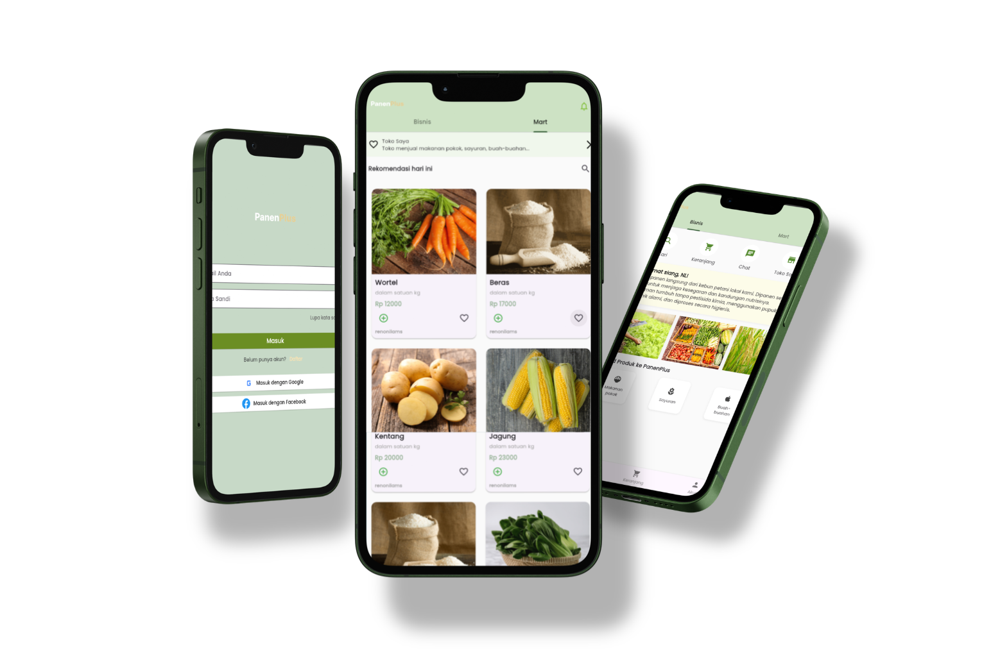

# 🌾 PanenPlus: Agricultural E-Commerce Platform

  

## 📌 Overview

**PanenPlus** is a comprehensive mobile e-commerce ecosystem designed to cut the middleman supply chain in the agricultural sector. Built with **Flutter** and **Dart**, this application enables local farmers to manage their digital storefronts and transact directly with consumers in a seamless, secure environment.

  

## 🚀 Core Features & Architecture

*   **Role-Based Access Control:** Secure user authentication supporting distinct logic for Buyers and Sellers using **Firebase Auth**.
*   **Real-time Marketplace & Cart Engine:** Dynamic product rendering, search filtering, and state-managed shopping cart operations.
*   **Comprehensive Seller Dashboard:** A dedicated interface for farmers to perform CRUD operations on products, track inventory stock, and update order statuses (Processed, Shipped, Completed).
*   **Checkout & Order Processing:** Automated subtotal calculations and shipping cost integrations.
*   **In-App Communication:** Real-time push notifications and direct chat system between buyers and sellers via **Cloud Firestore**.

## 💻 Tech Stack Implementation
*   **Frontend:** Flutter SDK, Dart, Material Design UI.
*   **Backend as a Service (BaaS):** Firebase (Authentication, Cloud Firestore for NoSQL database, Firebase Storage for image assets).
